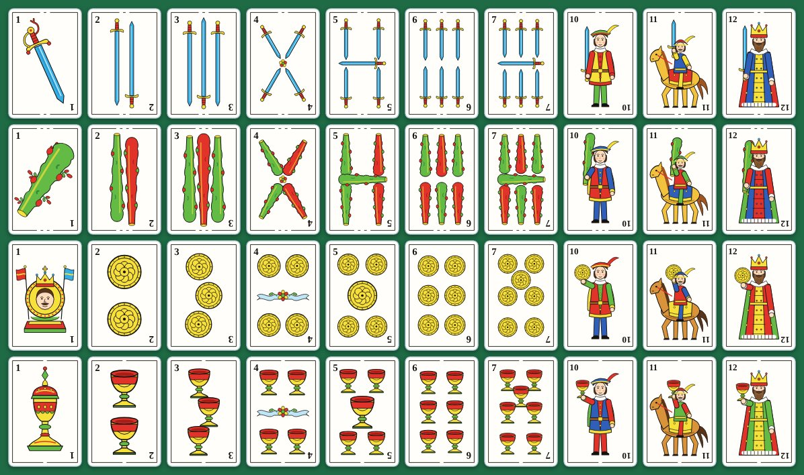
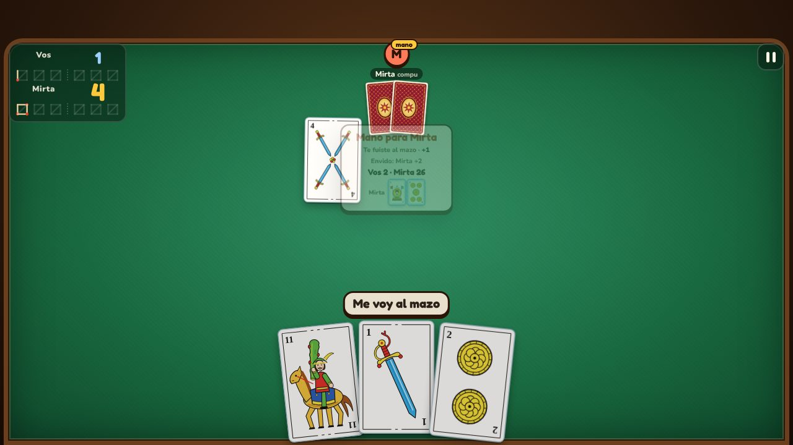
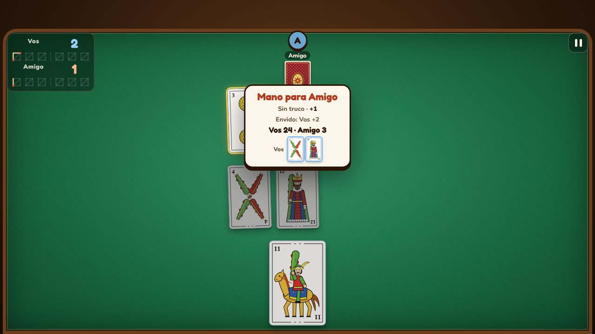
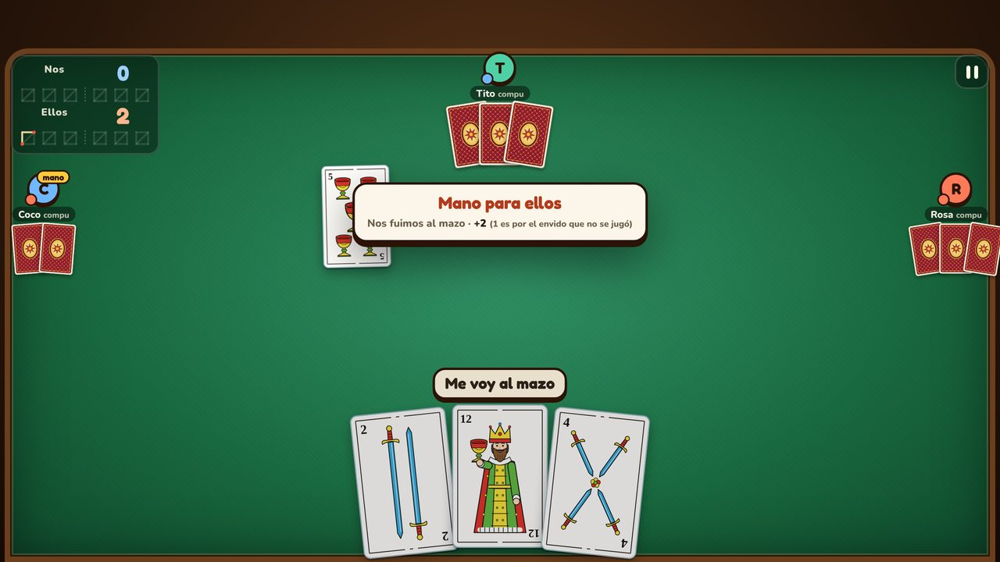
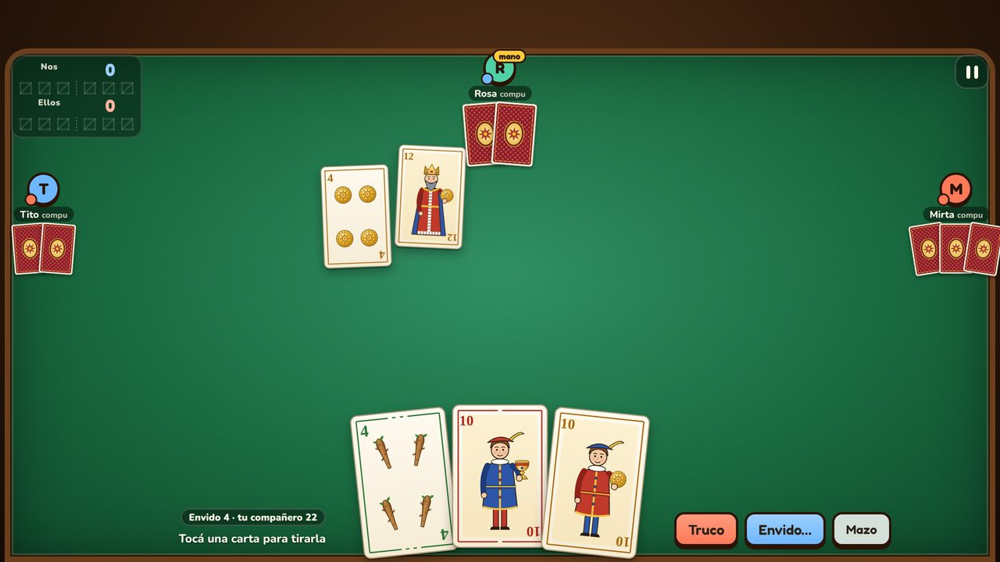

## Qué juego es

**Truco** (`public/games/truco/`). No es un juego nuevo: son arreglos de reglas que estaban mal, mejoras que pidieron
jugando y las cartas redibujadas como el naipe clásico argentino.

1. **Irse al mazo en la primera.** Antes daba solo lo que valía la mano (1 sin cantos). Si el envido todavía se podía
   cantar (primera baza, sin envido jugado ni truco querido), el rival se lleva además 1 por el envido: irse sin que nadie
   cante nada da **2**. Con el envido ya jugado, en la segunda baza o con el truco querido, sigue dando lo que vale la mano.
   Con flor en la mesa no hay envido que perder.
2. **En parejas, el envido lo cantan los pies.** De a cuatro, el envido lo cantan y lo contestan solo los pies, el último de
   cada pareja en tirar (el que repartió y el compañero del mano). Antes lo podía cantar cualquiera antes de tirar.
3. **El envido querido muestra los puntos de los dos.** Antes, si el segundo perdía decía «son buenas» y no se sabía cuánto
   tenía. Ahora dice «4, son buenas» (o «26 son mejores») y el resumen de la mano dice cuánto tenía cada uno: «Vos 4 · Cacho 23».
4. **Las cartas** (`public/shared/spanish-deck.js`, también las usa Escoba) copian el naipe clásico que se juega en
   Argentina: colores planos y vivos con contorno negro, números negros, oros con su flor, copas rojas, amarillas y verdes,
   espadas celestes con puño rojo, bastos verdes y rojos con nudos, el 3 en zigzag, el 4 con la cinta y la flor (en X en
   espadas y bastos), el 5 en H, el 6 y el 7 en filas, los anchos grandes y las figuras de cuerpo entero. Todo dibujado con
   código, sin las marcas de ningún fabricante.
5. **El tanteador es más grande** cuando hay lugar (computadora y tablet), para que se lea bien en el 1 vs 1 online. En el
   celular acostado queda como estaba, para no tapar a los de los costados.

## Cómo se juega

Igual que antes. Lo que cambia en la mesa:

- El resumen de la mano lo aclara: «Nos fuimos al mazo · +2 (1 es por el envido que no se jugó)».
- De a cuatro, el que no es pie ve «Envido 27 · lo canta Rosa» y no tiene el botón de envido. El pie ve «Envido 4 · tu
  compañero 22»: cada uno sabe los puntos de su compañero mientras se puede cantar, como si le hiciera la seña. La compu
  también los usa. Sin esto, el que no es pie no tendría cómo hacer valer su envido.
- El primer truco de la mano lo contesta el pie rival si todavía no tiró, para que pueda contestar con envido (el envido
  está primero). Después, como antes, lo contesta el que sigue.
- La ayuda (en español e inglés) y el README explican las reglas nuevas.

Mano a mano no cambia nada del envido: cada uno es su propio pie.

## Checklist

- [x] Todo está en `public/games/truco/`, más la baraja compartida `public/shared/spanish-deck.js` (Escoba la usa igual,
      sin cambios en su código), el README y `tests/truco.test.mjs`. El servidor online no cambia: usa la misma mesa.
- [x] Textos nuevos en español e inglés según `GameIt.prefs.lang`.
- [x] Lo probé en el navegador: partidas contra la compu (1 vs 1 y 2 vs 2, en computadora y en celular acostado) y un
      1 vs 1 online con dos navegadores, sin errores en la consola.
- [x] `npm run check` y `npm run build` pasan, y `npm test` también (1062 pruebas). Hay pruebas nuevas del truco (los
      pies, el mazo con y sin envido, flor y de a cuatro, quién canta y contesta el envido, el truco contra el pie, los
      puntos de los dos en el envido y cuántas espadas tiene cada carta).
- [ ] Dejé tildado "Allow edits by maintainers".

## Capturas

| | |
|---|---|
|  |  |
|  |  |

🤖 Generated with [Claude Code](https://claude.com/claude-code)

https://claude.ai/code/session_01VRU32TvSy1do7AcAzADaXU
