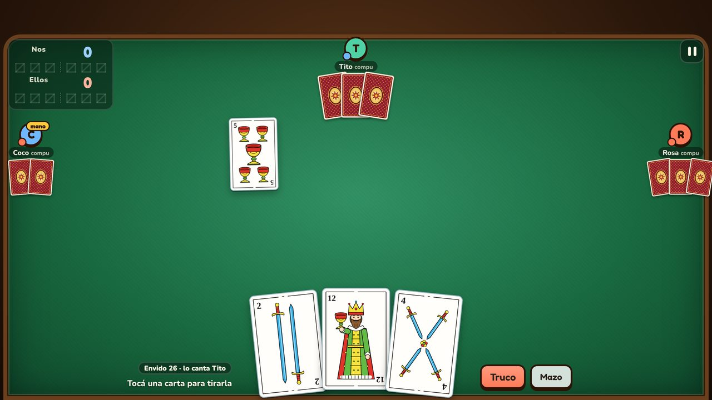

## Qué juego es

**Truco** (`public/games/truco/`): no es un juego nuevo, son dos arreglos de reglas del truco argentino que estaban mal.

1. **Irse al mazo en la primera.** Antes daba solo lo que valía la mano (1 sin cantos). Si el envido todavía se podía
   cantar (primera baza, sin envido jugado ni truco querido), el rival se lleva además 1 por el envido: irse sin que nadie
   cante nada da **2**. Con el envido ya jugado, en la segunda baza o con el truco querido, sigue dando lo que vale la mano.
   Con flor en la mesa no hay envido que perder.
2. **En parejas, el envido lo cantan los pies.** De a cuatro, el envido lo cantan y lo contestan solo los pies, el último de
   cada pareja en tirar (el que repartió y el compañero del mano). Antes lo podía cantar cualquiera antes de tirar.

## Cómo se juega

Igual que antes. Lo que cambia en la mesa:

- El resumen de la mano lo aclara: «Nos fuimos al mazo · +2 (1 es por el envido que no se jugó)».
- De a cuatro, el que no es pie ve «Envido 27 · lo canta Rosa» y no tiene el botón de envido. El pie ve «Envido 4 · tu
  compañero 22»: cada uno sabe los puntos de su compañero mientras se puede cantar, como si le hiciera la seña. La compu
  también los usa. Sin esto, el que no es pie no tendría cómo hacer valer su envido.
- El primer truco de la mano lo contesta el pie rival si todavía no tiró, para que pueda contestar con envido (el envido
  está primero). Después, como antes, lo contesta el que sigue.
- La ayuda (en español e inglés) y el README explican las dos reglas.

Mano a mano no cambia nada del envido: cada uno es su propio pie.

## Checklist

- [x] Todo está en `public/games/truco/` (más el README y `tests/truco.test.mjs`). El servidor online no cambia: usa la
      misma mesa (`shared/table.js`).
- [x] Textos nuevos en español e inglés según `GameIt.prefs.lang`.
- [x] Lo probé en el navegador: una partida de 2 contra 2 a 15 contra la compu entera, sin errores en la consola.
- [x] `npm run check -- truco` y `npm run build` pasan, y `npm test` también (1062 pruebas). Hay 6 pruebas nuevas del truco
      (los pies, el mazo con y sin envido, flor y de a cuatro, quién canta y contesta el envido, y el truco contra el pie)
      y se actualizaron las dos que esperaban la regla vieja.
- [ ] Dejé tildado "Allow edits by maintainers".

## Capturas

| | |
|---|---|
|  |  |
|  | |

🤖 Generated with [Claude Code](https://claude.com/claude-code)

https://claude.ai/code/session_01VRU32TvSy1do7AcAzADaXU
